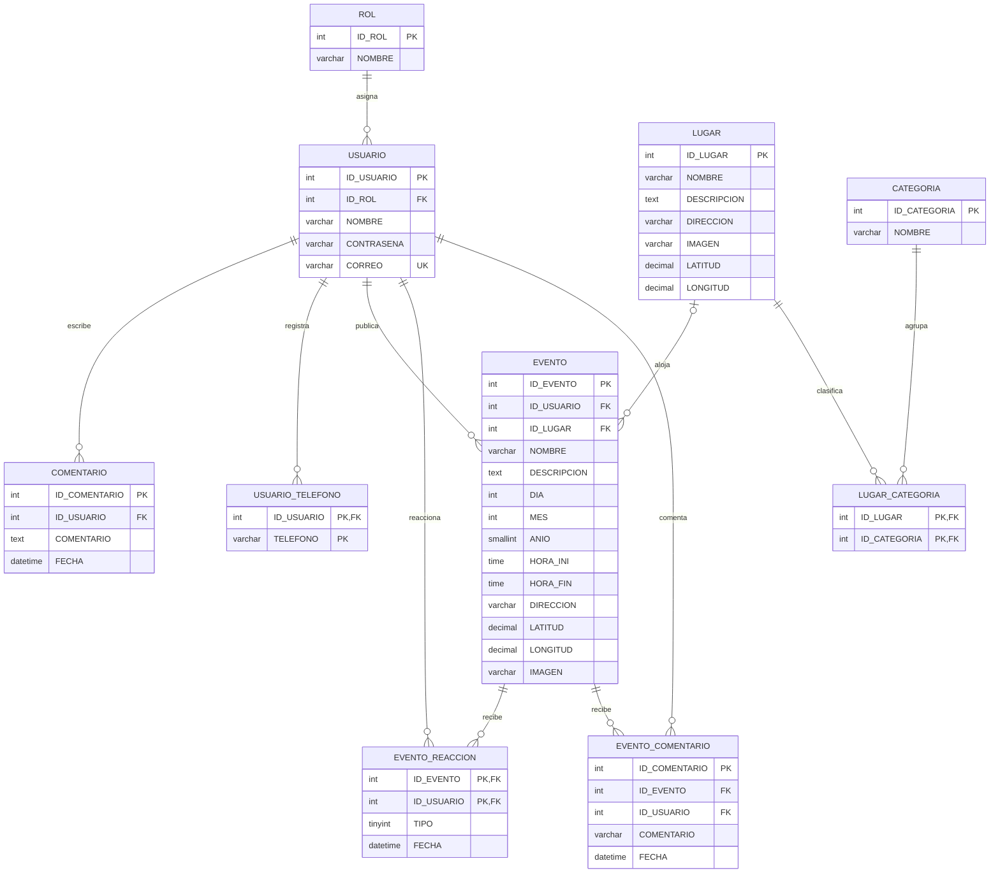

# Modelo Entidad-Relación y Modelo Relacional

Este modelo documenta la base de datos de SIGTUR. El esquema ejecutable y los datos de ejemplo se encuentran en [`../proyectoutu.sql`](../proyectoutu.sql).

## Modelo Entidad-Relación

`LUGAR` y `CATEGORIA` tienen una relación muchos a muchos, resuelta por `LUGAR_CATEGORIA`. `EVENTO.ID_LUGAR` admite valores nulos: un evento puede no estar asociado a un lugar del catálogo.

## Modelo relacional

- **ROL**(**ID_ROL**, NOMBRE)
- **USUARIO**(**ID_USUARIO**, ID_ROL → ROL.ID_ROL, NOMBRE, CONTRASENA, CORREO [único])
- **USUARIO_TELEFONO**(**ID_USUARIO** → USUARIO.ID_USUARIO, **TELEFONO**)
- **COMENTARIO**(**ID_COMENTARIO**, ID_USUARIO → USUARIO.ID_USUARIO, COMENTARIO, FECHA)
- **LUGAR**(**ID_LUGAR**, NOMBRE, DESCRIPCION, DIRECCION, IMAGEN, LATITUD, LONGITUD)
- **CATEGORIA**(**ID_CATEGORIA**, NOMBRE)
- **LUGAR_CATEGORIA**(**ID_LUGAR** → LUGAR.ID_LUGAR, **ID_CATEGORIA** → CATEGORIA.ID_CATEGORIA)
- **EVENTO**(**ID_EVENTO**, ID_USUARIO → USUARIO.ID_USUARIO, ID_LUGAR → LUGAR.ID_LUGAR [opcional], NOMBRE, DESCRIPCION, HORA_INI, HORA_FIN, DIA, MES, ANIO, DIRECCION, LATITUD, LONGITUD, IMAGEN)
- **EVENTO_REACCION**(**ID_EVENTO** → EVENTO.ID_EVENTO, **ID_USUARIO** → USUARIO.ID_USUARIO, TIPO, FECHA)
- **EVENTO_COMENTARIO**(**ID_COMENTARIO**, ID_EVENTO → EVENTO.ID_EVENTO, ID_USUARIO → USUARIO.ID_USUARIO, COMENTARIO, FECHA)

Las claves compuestas se indican con todos sus atributos subrayados en negrita. La base también restringe el tipo de reacción a `-1` o `1` y valida que las coordenadas estén dentro de sus rangos y se almacenen en pareja.
