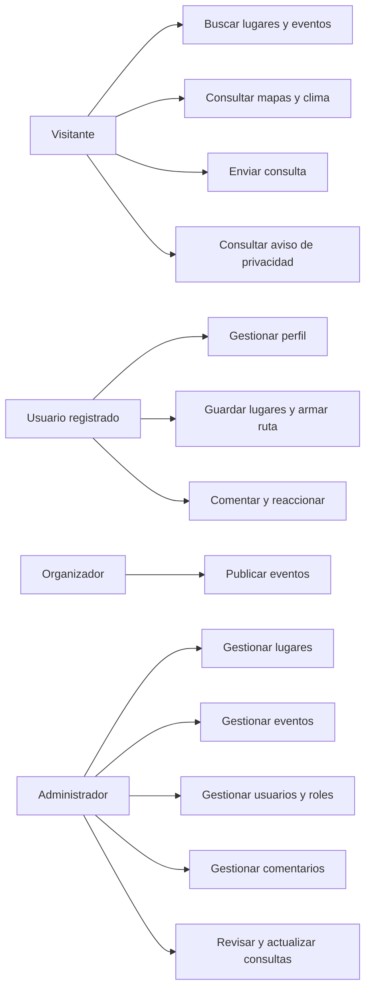
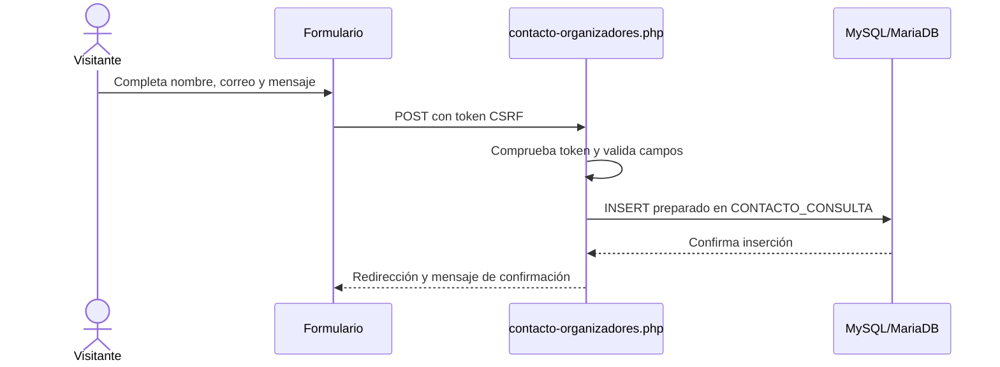

# Documentación del proyecto GoSalto / SIGTUR Salto

## 1. Propósito y alcance

SIGTUR Salto centraliza información turística de Salto, Uruguay. Desde la web se pueden explorar lugares, gastronomía y eventos; buscar y filtrar información; consultar mapas y clima; guardar lugares en una ruta; y participar con comentarios y reacciones. La administración gestiona el catálogo, eventos, usuarios, comentarios y consultas recibidas.

Esta documentación describe el código existente en el repositorio. No reemplaza las decisiones de negocio, las evidencias del equipo ni las pruebas presenciales que todavía deben completarse.

## 2. Requerimientos del sistema

### Funcionales

| ID | Requerimiento | Evidencia actual |
| --- | --- | --- |
| RF-01 | Navegar páginas turísticas y consultar lugares por categoría. | `pages/lugares/`, `pages/gastronomia/` |
| RF-02 | Buscar y filtrar lugares y eventos. | `pages/buscar.php`, `assets/js/busqueda-navbar.js` |
| RF-03 | Crear una cuenta e iniciar sesión con roles. | `pages/register.php`, `pages/login.php`, `pages/verificacionusuario.php` |
| RF-04 | Actualizar datos de perfil y teléfono. | `pages/perfil.php` |
| RF-05 | Publicar, reaccionar y comentar eventos. | `pages/eventos/eventos.php` |
| RF-06 | Administrar lugares, eventos, usuarios y comentarios según el rol. | `pages/admin/` |
| RF-07 | Guardar lugares y consultar una ruta personal. | `pages/favoritos.php`, `pages/guardar_favorito.php` |
| RF-08 | Enviar consultas a organizadores y permitir su revisión administrativa. | `pages/eventos/contacto-organizadores.php`, `pages/admin/consultas.php` |
| RF-09 | Consultar condiciones meteorológicas actuales mediante un servicio externo. | `assets/js/clima.js` |
| RF-10 | Consultar ubicaciones en mapas y, a pedido del visitante, mostrar su ubicación en el navegador. | `includes/mapa-categoria.php` |
| RF-11 | Descargar eventos para agregarlos a un calendario. | `pages/eventos/calendario.php` |

### No funcionales y seguridad

- Interfaz HTML5 adaptable a pantallas móviles y de escritorio; CSS utiliza Flexbox y Grid.
- PHP valida datos en el servidor; JavaScript aporta interacción y validaciones de interfaz, pero no sustituye la validación del servidor.
- Las consultas con datos variables deben utilizar sentencias preparadas.
- Las contraseñas nuevas se guardan mediante `password_hash`; la verificación utiliza `password_verify`.
- Las acciones que modifican datos requieren sesión/rol cuando corresponde, método HTTP apropiado y token CSRF.
- Las salidas dinámicas se escapan para HTML; los datos que se insertan en JavaScript se codifican según el contexto.
- Las sesiones comparten configuración en `config/sesion.php`: modo estricto, cookies HttpOnly y SameSite=Lax; Secure se activa sobre HTTPS.
- El navegador consulta clima, mapas y mosaicos de mapas a proveedores externos. La geolocalización solo se solicita tras una acción explícita y no se persiste.
- El acceso a base de datos se configura por variables de entorno en producción. La instalación XAMPP local conserva valores de desarrollo predeterminados.

## 3. Actores, historias y casos de uso

### Actores

- **Visitante:** explora y busca información, consulta mapas, clima y eventos.
- **Usuario registrado:** además comenta, reacciona, guarda lugares, organiza su ruta y actualiza su perfil.
- **Organizador:** participa y publica eventos de la comunidad.
- **Administrador:** gestiona el catálogo, usuarios, eventos, comentarios y consultas de contacto.

### Historias de usuario

1. Como visitante, quiero filtrar lugares y eventos para encontrar una propuesta de interés.
2. Como visitante, quiero ver los lugares en un mapa y decidir si comparto mi ubicación con el navegador.
3. Como usuario, quiero guardar lugares para planificar un recorrido.
4. Como usuario, quiero publicar comentarios y reacciones usando mi cuenta.
5. Como organizador, quiero publicar un evento con fecha, horario y ubicación.
6. Como administrador, quiero mantener actualizados los lugares, usuarios y publicaciones.
7. Como visitante, quiero enviar una consulta y saber que quedó registrada.
8. Como administrador, quiero revisar y eliminar consultas desde el panel.

### Casos de uso principales

| Caso | Actor | Flujo resumido |
| --- | --- | --- |
| UC-01 Buscar información | Visitante | Envía una búsqueda GET; el servidor valida filtros y devuelve resultados. |
| UC-02 Registrarse | Visitante | Completa el formulario; PHP valida, guarda hash y crea la sesión. |
| UC-03 Iniciar sesión | Usuario | Envía credenciales por POST; se verifica la contraseña y se regenera el ID de sesión. |
| UC-04 Guardar un lugar | Usuario | Envía el formulario protegido por CSRF; el lugar se asocia a su cuenta. |
| UC-05 Publicar evento | Usuario/Organizador | Completa datos, ubicación y portada opcional; PHP valida y persiste el evento. |
| UC-06 Administrar catálogo | Administrador | Crea, edita o elimina lugares y gestiona las relaciones de categoría. |
| UC-07 Enviar consulta | Visitante | Valida nombre/correo/mensaje, guarda el registro y muestra confirmación posterior al envío. |
| UC-08 Revisar consultas | Administrador | Consulta la bandeja protegida por rol y elimina mensajes mediante POST y CSRF. |

### Diagrama de casos de uso (resumen)

### Diagrama de secuencia: envío de consulta

## 4. Manual de usuario

### Explorar

1. Abrir la portada y utilizar la navegación o el buscador.
2. Elegir una categoría para ver lugares; los filtros disponibles dependen de la sección.
3. En una página con mapa, usar **Mostrar mi ubicación** solo si se desea pedir permiso al navegador. Si se deniega el permiso, el mapa continúa disponible.
4. Consultar eventos y aplicar los filtros de período o tipo disponibles.
5. Para publicar comentarios, reaccionar, guardar lugares o publicar eventos, crear una cuenta e iniciar sesión.
6. Consultar el aviso de privacidad desde el pie de página o desde el formulario de contacto.

### Cuenta y ruta

1. Elegir **Crear cuenta** y completar los campos requeridos.
2. Iniciar sesión con el correo y la contraseña.
3. Guardar lugares desde sus páginas o desde la búsqueda.
4. Abrir **Mi ruta** para revisar los lugares guardados y continuar hacia el recorrido en el mapa.
5. Usar el perfil para actualizar los datos permitidos.

### Contactar organizadores

1. Abrir **Eventos → Contactar a los organizadores**.
2. Completar nombre, correo y mensaje y enviar el formulario.
3. La página confirma el registro de la consulta. El equipo debe revisarla en Administración → Consultas.

### Administración

1. Iniciar sesión con una cuenta cuyo rol sea Administrador.
2. Entrar al panel para gestionar lugares, eventos, usuarios, comentarios y consultas.
3. En **Consultas**, cambiar cada mensaje entre **Pendiente**, **En seguimiento** y **Respondida**; eliminarlo solo cuando corresponda.
4. Los formularios de cambios requieren una sesión válida. Si una página estuvo abierta mucho tiempo y el token venció, recargarla y volver a enviar.
5. Eliminar registros es una acción permanente; confirmar solo después de verificar el elemento seleccionado.

## 5. Manual técnico e instalación local

### Requisitos

- Windows con XAMPP (Apache, PHP y MariaDB/MySQL).
- Extensiones PHP `mysqli`, `mbstring`, `fileinfo` y `curl` para las funciones que las requieren.
- Navegador moderno con JavaScript habilitado.

### Instalación nueva

1. Colocar el proyecto en `C:\xampp\htdocs\PROYECTO UTU`.
2. Iniciar Apache y MySQL desde XAMPP.
3. Importar `proyectoutu.sql` en MariaDB/MySQL.
4. Abrir `http://localhost/PROYECTO%20UTU/`.
5. Crear una cuenta desde el registro. Para probar administración localmente, asignar el rol 1 a una cuenta propia desde phpMyAdmin/MySQL. No habilitar esa promoción desde un endpoint público.

El volcado de instalación incluye el catálogo de lugares y las categorías; se retiraron cuentas, teléfonos, comentarios, eventos ficticios y cuatro lugares de prueba con direcciones genéricas. La información turística restante no se certifica como vigente solo por importarla. Crea una cuenta desde el registro; para probar administración localmente, asígnale el rol 1 en la base de datos. No hay credenciales de demostración predeterminadas.

### Actualización de una base existente

1. Hacer una copia de seguridad antes de cada migración.
2. Aplicar, en orden, las migraciones aún no aplicadas:
   - `database/migrations/20261019_integridad.sql`
   - `database/migrations/20261102_planificacion.sql`
   - `database/migrations/20261105_contacto_consultas.sql`
   - `database/migrations/20261106_consultas_estado.sql`
3. No ejecutar dos veces migraciones que agregan columnas o restricciones.

### Configuración de producción

Configurar fuera del repositorio `APP_ENV=production`, `DB_HOST`, `DB_NAME`, `DB_USER` y `DB_PASSWORD`. Usar un usuario MySQL con privilegios mínimos, HTTPS y contraseñas únicas. No desplegar la cuenta `root` ni la contraseña vacía que XAMPP permite como valor predeterminado local.

### Estructura relevante

- `assets/css/`, `assets/js/`, `assets/img/`: interfaz, comportamiento e imágenes.
- `includes/`: navegación, pie, comentarios y mapas reutilizables.
- `pages/`: páginas públicas, autenticación, eventos y administración.
- `api/`: endpoints auxiliares.
- `config/`: configuración de rutas, sesión e imágenes.
- `database/`: modelo y migraciones.
- `conexion.php`: conexión MySQL compartida.
- `proyectoutu.sql`: esquema y datos iniciales.

## 6. Pruebas y estado de validación

| ID | Prueba | Resultado esperado | Estado |
| --- | --- | --- | --- |
| PT-01 | Revisar sintaxis de todos los archivos PHP | Sin errores de sintaxis | Aprobada localmente (58 archivos) |
| PT-02 | Revisar sintaxis JavaScript | Sin errores de sintaxis | Aprobada localmente (8 archivos) |
| PT-03 | Enviar una consulta válida desde el formulario | Se guarda en MySQL y aparece confirmación | Aprobada localmente; registro temporal de prueba eliminado |
| PT-04 | Enviar un inicio de sesión POST sin token CSRF | Se rechaza con HTTP 400 | Aprobada localmente |
| PT-05 | Solicitar geolocalización tras pulsar el botón | Se actualiza el mapa sin persistir la ubicación | Aprobada localmente con ubicación simulada del navegador |
| PT-06 | `git diff --check` | Sin errores de whitespace | Aprobada |
| PT-07 | Registro e inicio de sesión con cuenta temporal de prueba | Cuenta y sesión operativas | Aprobada localmente; cuenta temporal eliminada |
| PT-08 | CRUD administrativo de lugar/evento/usuario/comentario | Cambios consistentes en BD y reflejados en la web | Pendiente de prueba funcional completa |
| PT-09 | Comprobar diseño en móvil/tablet y teclado | Navegación y controles utilizables | Smoke de desbordamiento aprobado en 320, 390, 768 y 1365 px; falta navegación completa con teclado y en dispositivos físicos |
| PT-10 | Probar migraciones en una copia limpia y una copia de datos | Esquema actualizado sin pérdida de datos | Aprobada localmente: importación limpia y migración sobre datos existentes; falta repetir con consultas preexistentes |
| PT-11 | Actualizar el estado de una consulta desde administración | Solo permite los estados previstos y conserva el cambio | Aprobada localmente; cambio verificado en MySQL y registro temporal eliminado |

Estas pruebas son evidencia acotada, no una certificación de ausencia de errores ni una auditoría de seguridad completa.

## 7. Entregables que requieren información del equipo

No se deben inventar resultados ni atribuirlos al grupo. Completar antes de la entrega:

- **Carátula institucional:** nombres y apellidos oficiales, grupo, asignaturas, docentes y fechas requeridas por el centro.
- **Ingeniería de software:** validar historias, prioridades, criterios de aceptación y responsables con el equipo; agregar wireframes y diagramas UML complementarios si los exige el docente.
- **Testing:** repetir PT-07 a PT-11 en el entorno de entrega, completar los aspectos pendientes, registrar fecha, entorno, responsable, resultado real y capturas sin datos personales.
- **Sistemas operativos:** documentar la instalación GNU/Linux realizada por el equipo, servicios configurados, scripts, permisos, firewall, backups y evidencia de restauración. El repositorio solo describe ejecución local en XAMPP; no demuestra que esa práctica se haya realizado.
- **Emprendedurismo:** completar misión, visión, FODA, público objetivo, entrevistas/estudio de mercado, estrategia de difusión y viabilidad económica con fuentes y supuestos propios.
- **Defensa y anexos:** agregar capturas originales, manual exportado al formato solicitado y código QR del repositorio si corresponde.

## 8. Trazabilidad de actividades de aula

Los prácticos de estructura HTML/CSS, responsive, Flexbox/Grid, manipulación del DOM, cambio de `src`, estilos dinámicos, condicionales, formularios, `fetch`, conexión PHP-MySQL, CRUD, validaciones, GET/POST, sesiones/roles, hashing y consultas preparadas se reflejan en las páginas y scripts indicados en `README.md`.

Los foros, reflexiones, Padlet, presentaciones y archivos ZIP del aula virtual son actividades de aprendizaje, no funcionalidades del producto. Se documentan o entregan en el aula según la consigna del docente; no se simulan dentro del sitio.
